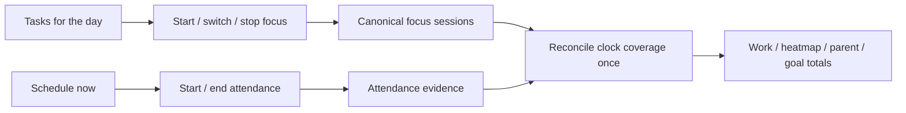

# Marina iPhone widgets: market study and build/test checklist

Research checked: **19 October 2026, Asia/Beirut**. This is a research-first implementation plan for the newly requested two-widget system. Competitor findings below come from official documentation, not hands-on testing of those apps. Checked boxes record evidence already obtained; unchecked boxes are future work.

## Top priority: one-tap Home Screen task launcher

Build this as the **first user-facing milestone**, after the shared queue, credential, and timer-accounting prerequisites below. It takes priority over the richer wheel, notification enhancements, and Live Activity. The first five boxes record implementation and automated verification; OS-hosted and physical-phone acceptance remain separate unchecked requirements.

- [x] Small Home Screen widget: show one suggested task with a direct Start action; one tap selects that task and starts its canonical work timer without opening the app.
- [x] Medium Home Screen widget: show up to three named today tasks, including eligible subtasks with short parent context. Tapping a task selects and starts it in one action; provide a discreet next-page control for more choices.
- [x] Rank suggestions by the single unambiguous current event's linked actionable task, then explicit today pins/order, then recent unfinished work within today's queue. Multiple eligible tasks or overlapping events show choices rather than guessing. Deduplicate stable task IDs.
- [x] Suggestions and calendar changes never start work on their own. A user's tap is required; stale or ineligible targets fail visibly without starting a different task.
- [x] While running, show the task, elapsed time, and a small accessible **×** to stop. Stop does not complete/delete the task or end calendar attendance. Starting another task uses the shared atomic switch, with no duplicate minutes.
- [ ] Keep controls restrained with comfortable touch targets, accessible names, and long-title/large-text support. The custom hold-and-slide wheel remains in the native sheet.
- [ ] Verify on actual hosted small/medium widgets: one tap starts the captured task without opening Marina, paging only changes choices, double taps/retries create one session, and concurrent web/phone actions cannot replace a newer timer silently. Check stale/offline/empty/overlapping states and cross-client totals before release.

Implementation references: [Apple interactive widget actions](https://developer.apple.com/documentation/widgetkit/adding-interactivity-to-widgets-and-live-activities) and [Timery's direct timer controls and widget paging](https://www.timeryapp.com/).

### First milestone implementation status — 19 October 2026

The Home Screen launcher, native today-task chooser, derived calendar membership, explicit day picks, scoped focus credentials, durable command retries, and atomic ordinary timer switching are implemented. PostgreSQL verification covers 36 cases across the new widget and existing schedule/timer suites, including unfinished work that exceeds its estimate. TypeScript, website build, serverless entry, and Vercel preflight pass. The full unit run passed 1,402 tests; the four Time view timeout failures passed on an isolated rerun with a 15-second timeout (no assertion changes). One later database run hit a setup timeout; all 36 passed after rerunning with a longer setup allowance.

[Native release build 8669424](https://github.com/Abkob/Marina/actions/runs/39173594989) passes seven Swift client tests, device app/extensions compilation and ad-hoc signature verification, and four Simulator UI tests: check-in gesture, today-task start/switch/stop, new widget layout gallery, and existing widget gallery. The IPA SHA-256 is `0368795f6794a497b4353cb27c834d4cc148ce9a45a4950c20f14c60051f8793`. The gallery was visually inspected; it is not an OS-hosted widget test. A live deployed context read succeeded using temporary keys; schedule-only and general-API access boundaries and revocation passed. Those keys were revoked and no production timers or day selections were changed by the live checks.

The current production backup was privately uploaded, hash-verified, and restored into a separate database (63 tables, 4,940 rows). Migration M-036 was rehearsed there before production; every existing table retained its row count. The new tables start empty; no development data replaced production data.

**Deliberate first-release boundary:** a running legacy calendar timer must be ended explicitly in calendar check-in before switching to task work. Its focus/attendance coupling is not silently broken. Fully independent attendance/focus, the richer task wheel, the two new Lock Screen configurations, and actual widget-host/physical-phone acceptance remain unfinished. The unchecked acceptance items above must not be interpreted as fully certified by a SwiftUI layout screenshot.

## Recommended product

Build two separate Lock Screen widgets in the existing Marina widget extension:

1. **Tasks for the day** — a deliberately chosen daily work queue, showing the selected task or running focus task. A play button starts work; a small **×** stops work without completing or deleting the task. Tapping the task opens a compact native picker with the requested hold, slide through tasks, and release-to-start interaction.
2. **Schedule now** — the calendar occurrence happening at the current time, with its explicit attendance/check-in state. Started and Ended record actual boundaries. A passed event with a missing end remains unconfirmed while the widget moves on to the next current occurrence.

Use direct actions on the Lock Screen and the richer wheel inside the native sheet. Consider a local Live Activity for the running work timer after the core flow works. A custom scrolling/hold wheel inside a WidgetKit Lock Screen widget is **not a supported implementation target**. An expanded native notification can host custom interaction, but is a separate OS surface and requires its own expansion gesture.

The backend must distinguish **calendar attendance**, **focused work**, and **task completion**. They can describe the same period without creating multiple copies of credited time.

## 1. What the market actually does

| Product and official evidence | Documented approach on Apple devices | Useful idea for Marina | Boundary / caution |
|---|---|---|---|
| [Timery](https://timeryapp.com/presskit.html) | Saved timers, recent-entry suggestions, interactive Home/Lock Screen widgets to start/stop entries, Live Activities, and tools for splitting entries. It uses Toggl's account/service. | A very small running-timer control, familiar task choices, and a good correction/split flow. Different clients can share one ledger. | The documentation does not establish a custom hold-and-scroll wheel in a Lock Screen widget. |
| [Toggl Track for iOS](https://support.toggl.com/en-us/article/toggl-track-timer-for-ios-8ew1yp/) | Phone/web synchronization; separate start-entry, running-entry, and suggested-entry widgets; current entry visible through Live Activities. | Keep current work visible and make starting a known item easy. The native surface should use Marina's existing cloud timer. | A widget showing a running entry is different from a calendar widget showing what was planned for now. |
| [Structured widgets](https://help.structured.app/en/articles/330498) and [Focus Timer](https://help.structured.app/en/articles/331010) | Separate timeline, single-task, and subtask Home Screen widgets; Lock Screen icon/info widgets; a focus view with notes/subtasks and a Live Activity. | Show parent context while focusing on an actionable child; separate timeline navigation from the work session. | Its documented focus timer ends when the task's scheduled time expires. Marina should preserve the user's explicit-end requirement instead of adopting that behavior. |
| [TickTick widgets](https://help.ticktick.com/articles/7055780404896202752) and [Focus](https://help.ticktick.com/articles/7055782010496745472) | Separate task/focus surfaces and Control Center entry points including Today's Tasks, Pomodoro, Stopwatch, and Open Focus; focus can be associated with a task. | Separate intent-specific controls instead of one crowded widget. | The reviewed sources do not prove independently timed note-checkbox items or a scrolling task wheel on the Lock Screen. |
| [Things widgets](https://culturedcode.com/things/support/articles/2803567/) | Widgets can target Today, projects, areas, and filters. Lock Screen choices include a list and progress. Secondary add controls can be hidden. | A genuinely selected Today list, restrained secondary controls, and useful project context. | Things documents calendar-freshness limitations in its widgets. Marina should expose stale state rather than guarantee instant calendar updates. |
| [Sunsama planned/actual time](https://help.sunsama.com/docs/usage-guides/tasks/planned-and-actual-times/) and [settings](https://help.sunsama.com/docs/settings/user-settings/) | Planned and actual durations are separate; individual subtasks can have estimates, actual time, and timers. Mobile settings include time-dial increments and left-handed mode. | Time an actionable subtask, retain its parent context, and support fast time correction. | Its optional planned-as-actual setting is not evidence of work. The subtask guide is not proof that every desktop interaction is available identically on iPhone. |

Additional gesture precedent: TickTick documents holding and dragging its **in-app** add control to select recording mode. This is useful evidence for placing a rich gesture in an app-owned control, not evidence that the same gesture is available in an Apple Lock Screen widget. [Official add-task guide](https://help.ticktick.com/articles/7055782422935240704).

**Synthesis:** borrow Timery/Toggl's small timer controls, Things' intentional daily list, Structured's child-task context, and Sunsama's separation of estimates from recorded work. Keep Marina's explicit attendance and correction rules. None of the reviewed official guides demonstrated the exact requested hold-wheel inside a Lock Screen widget; this is a documentation finding, not a claim about every app in the market.

## 2. Apple surfaces and the closest feasible interaction

| Surface | Planned Marina behavior | Constraint |
|---|---|---|
| Lock Screen rectangular widget | Task/event title, short state or elapsed time, one clear start/stop action, link to the relevant sheet. | App Intent buttons/toggles and navigation links; no arbitrary scrolling wheel. Authentication is required on a locked device. |
| Home Screen widget — top priority | Small: suggested task with direct Start. Medium: up to three one-tap task choices and discreet paging. Running: task, elapsed time, and Stop. | App Intent combines explicit task selection and Start in one action. Paging/browsing never starts work; no custom drag wheel. |
| Native quick sheet | Hold, move vertically through a small wheel, release to start/switch focus; drag out to cancel. Ordinary selection plus Start is the accessible alternative. | App-owned interaction; opening from the Lock Screen may require unlocking. |
| Expanded native notification | Optional reminder containing the relevant time control or task picker. | The OS presents and expands the notification first. Never promise one continuous gesture through system expansion and the custom control. |
| Live Activity | Optional running-task title, elapsed work clock, stop, and link to the picker. | Good for ongoing work, not an unrestricted mini-app or scroll wheel. Local ActivityKit and remote APNs updates are different implementations. |
| iOS controls / Shortcuts | Optional quick entry points after the main flow is validated. | They do not bypass the widget interaction or device-authentication restrictions. |
| Marina PWA | Full web interface and the web version of the daily queue. | Adding the website to the Home Screen does not install a WidgetKit extension. |

Apple references: [widget interactivity and authentication](https://developer.apple.com/documentation/widgetkit/adding-interactivity-to-widgets-and-live-activities), [WidgetKit surface types](https://developer.apple.com/documentation/widgetkit/), [Live Activities](https://developer.apple.com/documentation/activitykit/displaying-live-data-with-live-activities), and [custom notification content](https://developer.apple.com/documentation/usernotificationsui/customizing-the-appearance-of-notifications).

Keep both widget configurations in a `WidgetBundle` inside **one existing extension**. Two widget choices do not require two new extension targets. [Apple's extension guidance](https://developer.apple.com/documentation/WidgetKit/Creating-a-Widget-Extension?changes=_9).

Keep the current bundle identifiers across builds. AltStore's limit concerns registered app/extension IDs, not a fresh identity for each build. Free signing still needs periodic refresh. Verify App Groups and the retained extensions on the actual phone. [AltStore App IDs](https://faq.altstore.io/altstore-classic/app-ids), [Apple Personal Team limits](https://developer.apple.com/help/account/basics/about-your-developer-account).

## 3. Current Marina baseline — inspected, not assumed

Baseline source: **`6e4a564f9f8abfa7870ec1986921ad9f11ba1f4d`**. [Successful native build/test run](https://github.com/Abkob/Marina/actions/runs/39169496791).

- [x] Existing full-app `WKWebView` container, one schedule widget, native check-in sheet, and notification extension build for device and Simulator.
- [x] Five Swift client tests pass, including stable retry IDs, overlap selection, and original-session end commands.
- [x] Two Simulator UI tests pass: the actual UIKit hold-and-slide control with offline fixtures, and the SwiftUI widget-state gallery.
- [x] A real touch failure was caught before installation: event-row whitespace was not tappable. The entire row now has a touch shape; the chosen time card appears first.
- [x] Existing original-checkout work was preserved: 46 modified and 78 untracked files retained identical hashes while updating the checkout.
- [ ] These tests do **not** validate the newly requested daily-work widget, a task-selection wheel, actual SpringBoard widget hosting, production pairing, or every web feature inside WebKit.
- [ ] Verify physical-phone signing, App Groups, notification presentation, locked-device authentication, and background behavior.

The existing rectangular Lock Screen schedule view is currently a **link into check-in**, not the new two-widget start/stop system. The gallery is a layout preview, not proof of widget-host interaction.

### Important code findings

| Existing implementation | Consequence for the new work |
|---|---|
| [Task tree](../src/utils/taskTree.ts), [TaskTree UI](../src/components/TaskTree.tsx), and [work hierarchy](../shared/workHierarchy.ts) already represent stable task IDs, parents, and rollup rules. | Reuse them. Do not create copied daily tasks or duplicate a child to obtain a timer target. |
| Work selection filters future critical-path scaffolding; explicitly started CP work can be selectable. | Retain this distinction while expanding a linked branch into actionable children. |
| [Work timer service](../server/services/workTimer.ts) uses the shared `marina-active-work-timer` advisory lock and an idempotent session ID. An existing running timer makes ordinary start return `started: false`. | A new client must inspect the result; it cannot treat every HTTP 200 as a new start. Switching needs an explicit atomic operation. |
| [Schedule start](../server/services/scheduleStart.ts) creates a linked timer and leaves earlier activities awaiting their end. | Preserve missing-end evidence. Do not bolt on a parallel daily-work stopwatch. |
| [Schedule reconciliation](../server/services/scheduleReview.ts) subtracts recorded clock coverage and skips attendance fallback when `outcome.session_id` is set. | Decoupling attendance from focus requires changing this coupling deliberately. Clearing, replacing, or reusing a session ID casually can lose or duplicate credit. |
| [Schedule shortcut routes](../server/routes/schedule-shortcuts.ts) intentionally cannot stop unrelated work timers. | Do not silently turn existing schedule-only keys into general timer credentials. |
| [Cloud timer hook](../src/hooks/useCloudWorkTimer.tsx) polls the canonical server timer and invalidates related queries when its identity changes. | The web/native/widget surfaces should converge on this same state, with explicit refresh for edits that keep the timer identity. |

The user's “P subchecklists” is provisionally treated as parent/CP branches and their actionable descendants. The reviewed task/work paths have task rows with `parent_task_id`; a separate independently timed note-checkbox entity was not established by this review. Identifying the exact UI/storage representation is a pre-build checklist item.

## 4. Product and data rules to build against

### Tasks for the day

- [ ] Derive membership from tasks linked to today's accepted calendar occurrences, plus explicit **Add to this day** selections.
- [ ] Store day membership as a relation to existing IDs, not a new copy of each task. A deadline alone must not silently assign a task to today's work queue.
- [ ] Expand a linked parent into eligible unfinished descendants; retain a short parent/goal breadcrumb for similarly named children.
- [ ] Deduplicate the same child linked through several events or ancestors.
- [ ] Use the existing inclusive/additive hierarchy rules. A container is navigation; a parent's distinct residual work is selectable only when it represents real additional work.
- [ ] Allow unestimated actionable work to be timed. Show unknown remaining work honestly; do not replace a missing estimate with zero.
- [ ] Exclude archived, inactive/non-actionable, and completed branches according to the existing visibility policy. Keep a running item visible with Stop even if its queue membership changes.
- [ ] Trace the exact P/CP/checklist control. Existing child tasks retain their IDs. A text-only checkbox must acquire a stable, explicit work identity before independent timing; do not key timers by line number or label text.
- [ ] Define pin/unpin, inherited calendar membership, child ordering, and next-day behavior. Removing a day link must not delete the task or its history.
- [ ] Keep the wheel's selection cursor separate from a running timer. Browsing candidates must not start work or rewrite calendar commitments.

### Two distinct clocks and a single contribution ledger

Target architecture (proposed):

- [ ] Separate calendar attendance boundaries from focused-work segments. Starting/stopping a focus timer must not silently confirm an event's missing end.
- [ ] Use one active focus timer across web, native app, and widgets. Release on **Switch focus** is an explicit boundary: close the old focus segment and start the new one atomically.
- [ ] Preserve an open attendance record while focusing on several children inside that event. Do not mark the whole event ended at the first child-task switch.
- [ ] Introduce typed start/end-attendance and start/switch/stop-focus commands. Do not reuse an undifferentiated “toggle” request across both widgets.
- [ ] Keep one canonical saved work session per focus segment. Its task owns the minutes; parent and goal totals roll up that record without adding another session.
- [ ] Retain existing linked schedule-timer history through a compatibility adapter. Design the transition from `outcome.session_id` before changing live records; do not mass-rewrite historical minutes.
- [ ] Reconcile confirmed attendance only against uncovered clock ranges. Recorded focus spans take priority, including corrections that reduce credited work within a longer observed span.
- [ ] Handle attendance confirmed while a focus timer is still running. Reserve its known clock coverage provisionally so later stopping it cannot duplicate already credited attendance fallback.
- [ ] Keep overlapping attendance attribution explicit. Global unique time must stay bounded by elapsed time; two ambiguous task/goal owners must not each receive full credit.
- [ ] Preserve Proposed, current accepted schedule, actual attendance, focus, and completion as separate facts. An elapsed plan is not evidence of attendance or completion.
- [ ] Keep Feel score as an attention signal, velocity as forecasting evidence, and uploads as workload/completion evidence. None of these multiplies recorded minutes. A missing expected duration is not “zero hours late.”

### Native interaction

- [ ] **Daily work widget:** selected/running task, short parent context when needed, elapsed clock, and one play/× action. Label × accessibly as **Stop work timer**; it never means delete or complete.
- [ ] **Schedule now widget:** select by today's actual calendar time, not simply the globally running timer. Show an overlap chooser when two occurrences are current.
- [ ] When event A passes and B is current, show B while preserving A's unresolved end in the review queue. Do not manufacture A's end or keep presenting A as the current plan indefinitely.
- [ ] Link the title to the matching native sheet using stable task/occurrence IDs, with no bearer token in URLs.
- [ ] Implement the wheel inside the quick sheet: hold, vertical movement with restrained haptics, release to start/switch, and a clear cancellation direction. Keep only a few candidates visible.
- [ ] Capture the selected ID and expected timer at gesture start; a concurrent reorder or refresh must not start a neighboring task by index.
- [ ] Provide ordinary picker/list selection plus Start for VoiceOver, Switch Control, keyboard access, and users who do not want the gesture.
- [ ] Keep mobile controls comfortable to touch, including row whitespace and small icon hit areas. Keep reminders, corrections, and connection controls in a discreet disclosure.
- [ ] Use a typed native view state for idle/running/saving/failed/stale. An uncertain save must not look like a successful stop.
- [ ] Add both configurations to one `WidgetBundle`. Reuse the existing app/extension identities.
- [ ] Evaluate a local Live Activity after the two-widget flow works. Add neither a new widget extension nor a paid APNs dependency merely to display a local running clock.

## 5. Implementation order and ownership

### A. Contract and source audit — product + backend + iOS

- [x] Research the six products above and Apple's supported surfaces.
- [x] Inspect Marina's task hierarchy, timer, schedule reconciliation, scoped-key routes, and current native widget implementation.
- [ ] Identify the exact P/checklist source component and persistent IDs.
- [ ] Specify the two widget states and how each maps to attendance/focus commands, including every transition from an existing linked schedule timer.
- [ ] Agree the semantics of completion separately from Stop. Initial widgets should focus on timer control; no implicit parent/child completion cascade.
- [ ] Freeze the API and accounting test cases before adding UI controls.

### B. Day queue and timer backend — backend

- [ ] Implement a shared pure queue builder, using existing task visibility/hierarchy rules and calendar links.
- [ ] Design additive day-membership storage only for facts that cannot be derived from existing links. Specify unlink behavior before schema work.
- [ ] Expose authenticated day-list membership routes and narrow widget context/start/switch/stop routes. Names such as `/api/day-work/context` are proposed contracts, not existing endpoints.
- [ ] Require stable command/session IDs, explicit target IDs, expected running state/revision, and validated UTC instants. Use the account timezone for day membership.
- [ ] Perform focus switching and reconciliation under the existing shared transaction lock. Reuse service functions rather than issuing competing timer writes from separate routes.
- [ ] Add a separate, explicit focus-control capability to new native connections. Existing schedule-only keys retain their existing authority; pairing explains the requested capabilities.
- [ ] Reject deleted/archived/ineligible targets, stale selections, impossible clock boundaries, and unauthorized generic-timer actions without losing the active session.
- [ ] Keep pending command ID and chosen stop time durable across app/extension termination and lost responses. Retry the same command; do not create a fresh timer.
- [ ] Make correction, conflict, expired-connection, and save-failure states visible in every client.

### C. Web and native day-work picker — web + iOS

- [ ] Add **Tasks for the day** to Work, with compact day selection, add/remove membership, child context, and the shared active timer.
- [ ] Keep linked calendar tasks distinguishable from explicit day picks; avoid an unexplained duplicate list of every overdue task.
- [ ] Add the native wheel and ordinary accessible selection flow over the same queue IDs.
- [ ] Use the same canonical commands from web, native sheet, widget intents, and any notification actions.
- [ ] Refresh both timer state and changed work/schedule totals after native actions, including corrections that do not change the running session ID.
- [ ] Deliver the top-priority small/medium Home Screen launcher first once backend prerequisites pass, then add the two Lock Screen configurations and richer wheel. A SwiftUI gallery alone is not acceptance evidence for OS-hosted widgets.

### D. Production data and delivery — backend + release

- [ ] Before production schema/data changes, create a **current** consistent database backup, a durable private cloud recovery copy, and a local recovery copy where practical.
- [ ] Verify cloud read-back/hash and restore into a separate disposable database; compare all table counts and referenced-file integrity. A GitHub push or native IPA does not back up app data.
- [ ] Rehearse additive migrations and compatibility behavior against a restored copy. Never replace production data with local fixtures or development data.
- [ ] Preserve existing row counts/history except changes explicitly caused by the user's new operations. Inspect before/after checks before enabling the new paths.
- [ ] Deploy backward-compatible backend support before the web/native clients need it; then verify Vercel's actual deployment and live read paths.
- [ ] Keep destructive integration tests pointed only at the disposable test database. Test pairing with a temporary revocable key, not a compiled-in credential.
- [ ] Verify automatic-backup scheduling and success after the change; retain the recovery manifest privately.
- [ ] Keep commit, website deployment, native artifact, and physical-phone verification statuses separate in the release report.

## 6. Required accounting and behavior tests

Each row below is a release requirement, not an assertion that it already passes for the proposed feature.

| ID | Case | Expected result |
|---|---|---|
| T01 | Same child linked to two events and its parent on the same day | One selectable child identity; one set of minutes. |
| T02 | Parent → CP branch → actionable child | Child is selectable with context. Future scaffolding is not misrepresented as executable work. |
| T03 | Independently actionable parent residual plus child work | Both may be selected, but their sessions remain distinct and roll up once. |
| T04 | Text checkbox is renamed/reordered or two children share a title | Stable identity prevents switching or crediting the wrong item. |
| T05 | An actionable task has no expected duration | Timer works; remaining time/estimate and hour lateness stay unknown where appropriate. |
| T06 | Thirty minutes of focus inside an unconfirmed one-hour calendar event | Thirty saved work minutes; attendance remains unknown. |
| T07 | Confirmed one-hour work attendance plus a 30-minute focus span inside it | Sixty unique credited minutes, not ninety; focus and attendance are still distinguishable. |
| T08 | Full one-hour focus span corrected to 30 credited minutes, plus confirmed attendance for the same hour | The correction stays 30; calendar fallback cannot restore removed work minutes. |
| T09 | Two confirmed attendance records claim the same hour | No 120-minute total. Resolve ownership without arbitrary full credit to both goals. |
| T10 | Focus A is explicitly switched to B at 10:20 | One atomic boundary, no gap/overlap introduced by separate requests; attendance is not silently ended. |
| T11 | Calendar attendance stays open while focus switches between two children | Both child segments keep correct task ownership; event start is retained and its end awaits explicit confirmation. |
| T12 | User stops work but has not ended the event | Work is stopped once; event end remains unconfirmed. |
| T13 | Attendance ends while user-owned focus continues | Attendance confirmation does not stop an unrelated focus timer; provisional coverage prevents duplicate credit. |
| T14 | A scheduled event ends on the clock and the next begins | Schedule-now follows the new plan; previous missing end remains in review. |
| T15 | Focus and event widgets start/stop concurrently with the web app | Shared server lock/state guards permit one valid transition; no duplicate sessions or silently stopped newer timer. |
| T16 | Server saves Start/Stop but its response is lost | Same-ID retry returns the original result; no new start or later stop boundary. |
| T17 | Queue order changes, selected task is removed, or another device starts work during a hold | Start the captured valid ID or reject visibly; never start the task now occupying that row index. |
| T18 | Task/calendar link is moved, removed, archived, or completed while its timer runs | No deletion of recorded work; retain a safe Stop/correction path and explain the changed target. |
| T19 | One child is timed for 30m, then viewed through parent and goal | Thirty total minutes, not ninety from three levels of display. |
| T20 | Completed parent has open/new children, or hierarchy contains a cycle/missing parent | Flag inconsistency; no invented completion, recursive crash, or inflated total. |
| T21 | Timer crosses local midnight, a timezone change, or a DST boundary | Stable UTC session; correct account-day attribution; no automatic stop at midnight. |
| T22 | Proposed block is unapplied, moved, skipped, future, or elapsed without confirmation | No actual-time credit based only on the plan. |
| T23 | Stopwatch exceeds its estimate; Feel score changes; a report is uploaded | No automatic completion or fabricated hours. Forecast changes remain separate from the ledger. |
| T24 | Expired/revoked key, offline save, process kill, or corrupted/stale cache | Visible failure/retry or reconnect; no false success, lost pending command, or unauthorized write. |

## 7. How to test before another AltStore install

### Automated backend and web tests

- [ ] Unit-test queue membership, descendant expansion, deduplication, visibility, and stable selection. Include unestimated and broken-hierarchy cases.
- [ ] Add PostgreSQL integration tests for T06–T16, particularly legacy schedule-timer conversion, corrected-minute preservation, atomic switching, and retries.
- [ ] Test narrow credential capabilities and backward compatibility with existing schedule-only shortcuts.
- [ ] Test the Work day list at mobile and desktop widths, with keyboard and touch access, real server failure responses, and empty/long lists.
- [ ] Run the repository's TypeScript check, unit suite, build, serverless-entry check, and Vercel preflight. Run database tests with the dedicated integration configuration and disposable database only.

Useful existing commands: `npm run lint`, `npm test`, `npm run test:integration`, `npm run build`, `npm run vercel:entry-check`, and `npm run vercel:preflight`. Use the project's Node 24 runtime and inspect the test-database target before running integration tests.

### macOS / iPhone Simulator

- [x] Existing native baseline: `swift test --package-path native/MarinaCore`, device app/extensions compile, check-in gesture UI test, and gallery screenshots.
- [ ] Extend Swift tests for the daily queue, two-widget selection, focus/attendance state, and durable focus-command retries.
- [ ] Add offline UI tests for wheel hold/release, cancel, ordinary selection, VoiceOver alternatives, and a queue refresh during the gesture.
- [ ] Exercise actual WidgetKit hosting and both configurations, not just the shared gallery view. Verify the action target and result after widget refresh.
- [ ] Test the expanded notification's time picker/wheel, large text, available height, cancellation, and OS expansion behavior.
- [ ] Test a locally running Live Activity if included; distinguish it from a static widget preview.
- [ ] Capture current screenshots for idle, running, switching, overlap, missing end, saving, retry, empty queue, and long child/parent titles.

The current GitHub Actions workflow runs on macOS and produces an IPA plus available preview/test artifacts without an Apple developer certificate. Its iOS 18.5 Simulator uses Apple's deployment-target workaround for [WebKit bug 293831](https://bugs.webkit.org/show_bug.cgi?id=293831); the device app still targets iOS 17. A passing Simulator run does not certify physical iOS 17 compatibility or every WebKit feature.

### One physical iPhone verification round

- [ ] Install/update through AltStore with the **same bundle identifiers** and retain both existing extensions. Verify App Group access with the actual signing account.
- [ ] Pair a revocable connection; add **both** Lock Screen widgets from the widget gallery. Verify they fit the chosen Lock Screen layout and remain legible.
- [ ] Test before first unlock, authenticated Lock Screen, after app termination, and with Lock Screen privacy settings changed. Do not promise unauthenticated actions.
- [ ] Start on web and stop on phone; start on phone and inspect web. Confirm a single canonical session and stable actual totals.
- [ ] Test offline Start/Stop and reconnect, including a response lost after the server committed the save.
- [ ] Verify local reminder permission, an actual event notification, expansion and time correction, stale calendar edits, and missing-end recovery the following day.
- [ ] Verify sign-in persistence, uploads/camera/file dialogs, downloads, external OAuth, and cloud-save failure display in the full app container.
- [ ] Refresh free signing before expiry and confirm updates preserve pairing/session state. Confirm no new widget configuration created a new extension App ID.

## Completion criteria

- [ ] Both named widgets are selectable in Apple's Lock Screen widget gallery and act on the intended task or occurrence.
- [ ] The task wheel starts the selected stable ID on release and has a reliable cancel/accessibility path.
- [ ] CP/parent/subtask behavior is explicit and tested; plain note checkboxes are not silently treated as independently timed task rows.
- [ ] Switching, overlap, corrections, retries, and attendance/focus coexistence pass the backend matrix without duplicate or erased minutes.
- [ ] Native screenshots, actual widget-host checks, and physical signing checks are recorded with their exact build and limitations.
- [ ] Backup verification, deployment readiness, preserved cloud data, and connection revocation are evidenced separately from the code push.

**Build priority:** agree the identity/state contract → prove the ledger and daily queue → deliver the one-tap Home Screen launcher → verify on Simulator and phone → build the richer picker and two Lock Screen configurations. Richer Live Activity/notification variants follow the same commands and accounting instead of introducing another timer engine.
